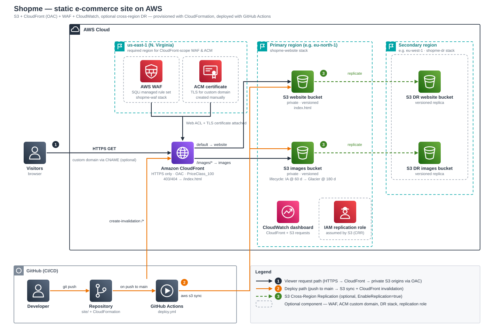

# Shopme Static Website Infrastructure

A secure, resilient static e-commerce storefront on AWS, provisioned with CloudFormation (Amazon S3, CloudFront with Origin Access Control, AWS WAF, CloudWatch, optional cross-region replication) and deployed automatically with GitHub Actions.

**Contents**
[Project scope](#project-scope) · [Architecture](#architecture) · [Services](#services-used) · [Free-tier guide](#free-tier-guide) · [Repository layout](#repository-layout) · [Deploy: AWS](#deploy-on-aws) · [Deploy: GitHub](#deploy-with-github-actions) · [Operations](#operations) · [Tear-down](#tear-down-keep-the-configuration)

---

## Project scope

**What it is.** Shopme is a single-page storefront (`site/index.html` plus product images). Product search and the shopping cart run entirely in the browser; "checkout" only shows a confirmation dialog.

**In scope**
- Private, versioned S3 hosting for the site and for product images, reachable only through CloudFront (OAC, HTTPS only).
- Optional AWS WAF (managed SQL-injection rule set), optional custom domain with an ACM certificate.
- Optional cross-region disaster recovery (S3 replication to a second region).
- A CloudWatch dashboard (CloudFront `Requests`, S3 `AllRequests`).
- Infrastructure as code (3 CloudFormation stacks) and CI/CD (push to `main` → S3 sync → cache invalidation).

**Out of scope**
- No backend, database, user accounts, payments or order processing. Cart state lives in the browser and is lost on reload.
- DNS records and the ACM certificate are created manually (see [`custom-domain-setup.md`](custom-domain-setup.md)); they are not part of the stacks.

---

## Architecture

<p align="center">
  
</p>

1. **Viewer request** — the browser connects over HTTPS (HTTP is redirected). CloudFront serves cached content; WAF (if enabled) inspects requests first. `/images/*` is routed to the images bucket, everything else to the website bucket. 403/404 from S3 return `/index.html` with status 200.
2. **Deploy** — a push to `main` runs GitHub Actions: sync `site/` to the website bucket, `site/images/` to the images bucket, then invalidate `/*`.
3. **Replication (optional)** — new objects in both buckets are copied asynchronously to versioned buckets in a secondary region.

Both buckets block all public access; only the specific CloudFront distribution may read them (bucket policy + OAC/SigV4). The S3 website endpoint is intentionally unusable.

### Three stacks, three regions

| Template | Region | Purpose | Required? |
|---|---|---|---|
| [`files/shopme-waf.yaml`](files/shopme-waf.yaml) | `us-east-1` (fixed by AWS) | CloudFront-scope WAF Web ACL (AWS managed SQLi rule set) | Optional |
| [`shopme-dr.yaml`](shopme-dr.yaml) | secondary region, e.g. `eu-west-1` | Versioned destination buckets for replication | Optional |
| [`shopme-s3-website.yaml`](shopme-s3-website.yaml) | primary region, e.g. `eu-north-1` | Buckets, CloudFront, OACs, bucket policies, replication role, dashboard | **Required** |

The split exists because a bucket lives in its stack's region and a `CLOUDFRONT`-scope Web ACL can only be created in `us-east-1`. The main stack receives the WAF and DR ARNs as plain parameters.

---

## Services used

| Service | Role in this project | Stack | Optional? |
|---|---|---|---|
| Amazon S3 (website bucket) | Hosts `index.html`; private, versioned | website | No |
| Amazon S3 (images bucket) | Hosts `/images/*`; private, versioned; lifecycle: Standard-IA at 60 days, Glacier at 180 days | website | No |
| Amazon CloudFront + OAC | Global HTTPS delivery, two S3 origins, SigV4-signed origin access | website | No |
| AWS WAF | SQL-injection protection on the distribution | waf | Yes (`EnableWAF`) |
| AWS Certificate Manager | TLS certificate for a custom domain (must be in `us-east-1`) | manual | Yes (`DomainName`) |
| Amazon CloudWatch | Dashboard with CloudFront and S3 request metrics | website | No (small cost, see below) |
| S3 Cross-Region Replication + IAM role | Disaster recovery copy of both buckets | website + dr | Yes (`EnableReplication`) |
| AWS CloudFormation | Provisions everything above | all | No |
| GitHub Actions | CI/CD | n/a | Yes (you can upload manually) |

> **Lifecycle caveat:** objects in Glacier cannot be served by CloudFront until restored. Re-upload images of products that are still listed after ~180 days (re-uploading resets the age). Replication copies objects as they are at upload time; later lifecycle transitions are *not* mirrored to the DR bucket.
>
> **Transfer Acceleration** is not supported in opt-in regions such as `eu-north-1` and is deliberately not enabled (it also causes HTTP 405 on buckets with website hosting).

---

## Free-tier guide

*Pricing and allowances below were checked on 2026-10-19 against AWS's own pages and can change. Verify on the [AWS Free Tier](https://aws.amazon.com/free/) and service pricing pages before relying on them.*

### 1. Which free offer applies to you

| Your account | What you get |
|---|---|
| Created **on/after 15 Jul 2025** | **Free plan**: $100 credits at sign-up, up to $100 more for completing onboarding activities (max $200). Lasts 6 months or until credits run out, whichever is first; no charges until you upgrade to the paid plan. Credits remain usable for up to 12 months from sign-up after upgrading. |
| Created **before 15 Jul 2025** | Legacy Free Tier: 12-month trial allowances (for S3: 5 GB Standard storage, 20,000 GET and 2,000 PUT requests per month) plus the always-free allowances. |
| Any | **Always-free** allowances (below) apply to both programs. |

### 2. What this project costs, service by service

| Service | Free allowance | This project | Verdict |
|---|---|---|---|
| CloudFront (pay-as-you-go) | Always free: 1 TB data out, 10 M requests, 2 M function invocations per month; first 1,000 invalidation paths per month free | One `/*` invalidation per deploy counts as 1 path. A small shop stays far below the limits. | **Free** |
| Amazon S3 | Credits (new accounts) or 12-month allowance (legacy); 100 GB/month internet egress free (aggregated). CloudFront → S3 origin traffic is not an internet egress cost. | A few MB of static files | **Free / pennies** |
| ACM public certificate | Free | Optional custom domain | **Free** |
| CloudFormation, IAM, OAC | No charge for AWS-resource stacks | | **Free** |
| CloudWatch | 3 dashboards (≤50 metrics each), 10 custom metrics | 1 dashboard. S3 request metrics (`MetricsConfigurations`) are billed like custom metrics (≈$0.30 per metric-month) and can exceed the 10 free. | **Small cost possible** |
| **AWS WAF** | **No free tier** | $5/Web ACL + $1/rule + $0.60 per million requests ≈ **$6/month** | **Not free** |
| **Cross-Region Replication** | **None** | Second copy of the data in the DR region + inter-region transfer (billed on the source region's rate) | **Not free** |
| GitHub Actions | Free minutes for public repositories; monthly allowance on private repos | One short job per push | **Free** |

### 3. Recommended free-tier configuration

Use **Configuration C** in [Deploy on AWS](#4-deploy-the-primary-stack): `EnableWAF=false`, `EnableReplication=false`. Skip the WAF and DR stacks entirely. You keep private buckets, OAC, HTTPS, CloudFront caching, a custom domain with a free ACM certificate, CI/CD and the dashboard.

To remove the only remaining possible charge, delete the `MetricsConfigurations` block on the website bucket and the S3 widget of the dashboard in `shopme-s3-website.yaml`.

### 4. Guard rails

- Create a **monthly cost budget** (AWS Budgets, e.g. $5) with email alerts; the free plan also sends credit alerts at 50/25/10 % remaining.
- Turn WAF and replication on only when you need them; both bill continuously, even with no traffic.
- When the free plan ends you have 90 days to upgrade before the account closes; to stop all spending instead, use the [tear-down](#tear-down-keep-the-configuration).
- *Alternative:* CloudFront also offers flat-rate plans (a $0 Free plan: 1 M requests, 100 GB, 5 WAF rules, no overage charges). They cannot be used by accounts on the AWS Free Tier, cover one distribution each, and are applied via console/CLI rather than this template, so this project does not use them.

---

## Repository layout

```text
.
├── site/                        # Deployed content (only this folder is synced)
│   ├── index.html               # Storefront (search + cart, client-side only)
│   └── images/                  # Product images → images bucket under images/
├── shopme-s3-website.yaml       # Main stack: buckets, CloudFront, OAC, replication role, dashboard
├── shopme-dr.yaml               # DR stack: destination buckets (optional)
├── .github/workflows/deploy.yml # CI/CD: sync + invalidate on push to main
├── docs/
│   ├── architecture.svg         # Architecture diagram (PNG copy alongside)
│   └── architecture.png
├── custom-domain-setup.md       # ACM certificate + DNS for a custom domain
├── deployment.md                # Detailed guide, troubleshooting table
├── deployment_ci.md             # Older two-stack guide (superseded by deployment.md)
├── files/                       # Earlier iterations and notes; contains shopme-waf.yaml (WAF stack)
└── README.md
```

---

## Deploy on AWS

### 1. Prerequisites

- An AWS account and an IAM identity allowed to create S3, CloudFront, WAF, IAM roles and CloudFormation stacks.
- [AWS CLI v2](https://docs.aws.amazon.com/cli/latest/userguide/getting-started-install.html) configured (`aws configure`) and this repository cloned.
- Optional: [GitHub CLI](https://cli.github.com/) (`gh`) for the secrets step.

### 2. Save your configuration once

Bucket names are globally unique. Put every choice in one file and `source` it before each command; this is also what makes [tear-down and redeploy](#tear-down-keep-the-configuration) repeatable.

```bash
mkdir -p config
cat > config/shopme.env <<'EOF'
export PRIMARY_REGION=eu-north-1        # main stack region (don't change after first deploy)
export DR_REGION=eu-west-1              # only used with replication
export WEBSITE_BUCKET=shopme-website-<account-id>
export IMAGES_BUCKET=shopme-images-<account-id>
export DR_WEBSITE_BUCKET=shopme-website-<account-id>-dr
export DR_IMAGES_BUCKET=shopme-images-<account-id>-dr
export WEB_STACK=shopme-website
export WAF_STACK=shopme-waf
export DR_STACK=shopme-dr
export DOMAIN_NAME=""                   # e.g. shop.example.com (optional)
export ACM_CERT_ARN=""                  # us-east-1 certificate for DOMAIN_NAME
EOF
source config/shopme.env
```

> Keep `config/shopme.env` private if it will contain real account IDs. It holds no secrets, but it is account-specific.

### 3. Optional stacks

**WAF (`us-east-1`)** — skip for the free-tier setup:

```bash
aws cloudformation deploy --template-file files/shopme-waf.yaml \
  --stack-name "$WAF_STACK" --region us-east-1

WAF_ACL_ARN=$(aws cloudformation describe-stacks --stack-name "$WAF_STACK" --region us-east-1 \
  --query "Stacks[0].Outputs[?OutputKey=='WebACLArn'].OutputValue" --output text)
```

**Disaster recovery (secondary region)** — skip if you don't need replication:

```bash
aws cloudformation deploy --template-file shopme-dr.yaml \
  --stack-name "$DR_STACK" --region "$DR_REGION" \
  --parameter-overrides DRWebsiteBucketName="$DR_WEBSITE_BUCKET" DRImagesBucketName="$DR_IMAGES_BUCKET"

DR_WEBSITE_ARN=$(aws cloudformation describe-stacks --stack-name "$DR_STACK" --region "$DR_REGION" \
  --query "Stacks[0].Outputs[?OutputKey=='DRWebsiteBucketArn'].OutputValue" --output text)
DR_IMAGES_ARN=$(aws cloudformation describe-stacks --stack-name "$DR_STACK" --region "$DR_REGION" \
  --query "Stacks[0].Outputs[?OutputKey=='DRImagesBucketArn'].OutputValue" --output text)
```

### 4. Deploy the primary stack

Pick one configuration. `CAPABILITY_NAMED_IAM` is required because the replication role has an explicit name.

**C — Minimal / free tier (no WAF, no replication)**

```bash
aws cloudformation deploy --template-file shopme-s3-website.yaml \
  --stack-name "$WEB_STACK" --region "$PRIMARY_REGION" \
  --capabilities CAPABILITY_IAM CAPABILITY_NAMED_IAM \
  --parameter-overrides BucketName="$WEBSITE_BUCKET" ImagesBucketName="$IMAGES_BUCKET" \
      EnableWAF=false EnableReplication=false
```

**B — WAF, no replication**

```bash
aws cloudformation deploy --template-file shopme-s3-website.yaml \
  --stack-name "$WEB_STACK" --region "$PRIMARY_REGION" \
  --capabilities CAPABILITY_IAM CAPABILITY_NAMED_IAM \
  --parameter-overrides BucketName="$WEBSITE_BUCKET" ImagesBucketName="$IMAGES_BUCKET" \
      WebACLArn="$WAF_ACL_ARN" EnableReplication=false
```

**A — WAF + replication (full)**

```bash
aws cloudformation deploy --template-file shopme-s3-website.yaml \
  --stack-name "$WEB_STACK" --region "$PRIMARY_REGION" \
  --capabilities CAPABILITY_IAM CAPABILITY_NAMED_IAM \
  --parameter-overrides BucketName="$WEBSITE_BUCKET" ImagesBucketName="$IMAGES_BUCKET" \
      WebACLArn="$WAF_ACL_ARN" EnableReplication=true \
      DestinationWebsiteBucketArn="$DR_WEBSITE_ARN" DestinationImagesBucketArn="$DR_IMAGES_ARN"
```

**Custom domain (any configuration):** first issue the certificate in `us-east-1` and validate it ([`custom-domain-setup.md`](custom-domain-setup.md)), then append `DomainName="$DOMAIN_NAME" AcmCertificateArn="$ACM_CERT_ARN"` to `--parameter-overrides`. Finally create the DNS `CNAME` from your domain to the `CloudFrontDomainName` output.

> Every `deploy` call must repeat **all** parameters you want to keep; omitted ones fall back to template defaults. Always redeploy to the stack's original region.

### 5. Upload content and verify

Capture the outputs you need (also used for GitHub secrets):

```bash
DISTRIBUTION_ID=$(aws cloudformation describe-stacks --stack-name "$WEB_STACK" --region "$PRIMARY_REGION" \
  --query "Stacks[0].Outputs[?OutputKey=='CloudFrontDistributionId'].OutputValue" --output text)
SITE_URL=$(aws cloudformation describe-stacks --stack-name "$WEB_STACK" --region "$PRIMARY_REGION" \
  --query "Stacks[0].Outputs[?OutputKey=='CloudFrontURL'].OutputValue" --output text)
```

Manual first upload (CI does the same later):

```bash
aws s3 sync site/ "s3://$WEBSITE_BUCKET" --exclude "images/*" --delete
aws s3 sync site/images/ "s3://$IMAGES_BUCKET/images/" --delete
aws cloudfront create-invalidation --distribution-id "$DISTRIBUTION_ID" --paths "/*"
curl -I "$SITE_URL"        # expect HTTP/2 200
```

The stack outputs also include `DashboardURL` (CloudWatch; allow up to ~15 minutes for the first S3 data points). Changes to a distribution take 5–15 minutes to propagate.

---

## Deploy with GitHub Actions

[`.github/workflows/deploy.yml`](.github/workflows/deploy.yml) runs on every push to `main` and on manual dispatch. It syncs `site/` (excluding `images/`) to the website bucket, syncs `site/images` to the images bucket under `images/`, and invalidates `/*`. Do this **after** the AWS deploy, because the distribution ID only exists then.

### 1. Create a least-privilege CI identity

Create a dedicated IAM user (no console access) with this policy, replacing the placeholders, and create an access key for it:

```json
{
  "Version": "2012-10-17",
  "Statement": [
    { "Effect": "Allow",
      "Action": ["s3:ListBucket"],
      "Resource": ["arn:aws:s3:::<website-bucket>", "arn:aws:s3:::<images-bucket>"] },
    { "Effect": "Allow",
      "Action": ["s3:PutObject", "s3:DeleteObject"],
      "Resource": ["arn:aws:s3:::<website-bucket>/*", "arn:aws:s3:::<images-bucket>/*"] },
    { "Effect": "Allow",
      "Action": "cloudfront:CreateInvalidation",
      "Resource": "arn:aws:cloudfront::<account-id>:distribution/<distribution-id>" }
  ]
}
```

### 2. Add the repository secrets

In **Settings → Secrets and variables → Actions**, or with the GitHub CLI:

```bash
source config/shopme.env
gh secret set AWS_ACCESS_KEY_ID        --body "<ci-access-key-id>"
gh secret set AWS_SECRET_ACCESS_KEY    --body "<ci-secret-access-key>"
gh secret set AWS_REGION               --body "$PRIMARY_REGION"
gh secret set S3_BUCKET_NAME           --body "$WEBSITE_BUCKET"
gh secret set IMAGES_BUCKET_NAME       --body "$IMAGES_BUCKET"
gh secret set CLOUDFRONT_DISTRIBUTION_ID --body "$DISTRIBUTION_ID"
```

| Secret | Value |
|---|---|
| `AWS_ACCESS_KEY_ID` / `AWS_SECRET_ACCESS_KEY` | CI IAM user's key pair |
| `AWS_REGION` | Primary stack region |
| `S3_BUCKET_NAME` / `IMAGES_BUCKET_NAME` | Website and images bucket names |
| `CLOUDFRONT_DISTRIBUTION_ID` | `CloudFrontDistributionId` output (**changes if you redeploy the stack**) |

### 3. Run it

Push a change to `main`, or **Actions → Deploy Shopme to S3 → Run workflow**. Confirm all steps are green and reload the site.

> **Hardening:** long-lived access keys are acceptable for a learning project. For production switch to OIDC: add the GitHub identity provider and a role trusted for this repository in IAM, set `permissions: id-token: write` in the workflow, and replace the key inputs of `aws-actions/configure-aws-credentials` with `role-to-assume`. Then delete the two key secrets.

---

## Operations

- **Update the site:** commit to `site/` and push to `main`.
- **Add/remove WAF:** deploy `files/shopme-waf.yaml`, then redeploy the main stack with `EnableWAF=true` and `WebACLArn`; to remove it, redeploy with `EnableWAF=false` *before* deleting the WAF stack.
- **Add/remove replication:** deploy the DR stack first, then the main stack with `EnableReplication=true`. Only objects uploaded afterwards are replicated; use S3 Batch Replication to backfill. To remove it, redeploy with `EnableReplication=false` before deleting the DR stack.
- **Troubleshooting:** see the table at the end of [`deployment.md`](deployment.md).

---

## Tear-down (keep the configuration)

This chapter removes every billable AWS resource but **keeps everything needed to rebuild the site identically**: the templates, `site/`, the workflow, `config/shopme.env`, a snapshot of stack parameters/outputs, the GitHub secret names, and (optionally) the ACM certificate. Redeploying later is a repeat of [Deploy on AWS](#deploy-on-aws).

> **Destructive and irreversible for the data in the buckets.** `site/` in Git is the source of truth, so the buckets can be rebuilt. Back up anything else first (step 1).

### 1. Snapshot the configuration

```bash
source config/shopme.env
mkdir -p config/snapshot
for S in "$WEB_STACK:$PRIMARY_REGION" "$WAF_STACK:us-east-1" "$DR_STACK:$DR_REGION"; do
  NAME=${S%%:*}; REGION=${S##*:}
  aws cloudformation describe-stacks --stack-name "$NAME" --region "$REGION" \
    --query "Stacks[0].{Parameters:Parameters,Outputs:Outputs}" > "config/snapshot/$NAME.json" 2>/dev/null \
    || echo "skip: $NAME not deployed"
done
gh secret list > config/snapshot/github-secret-names.txt     # names only; values can't be read back
# Optional: copy bucket contents locally (e.g. images uploaded outside Git)
aws s3 sync "s3://$IMAGES_BUCKET/images/" config/snapshot/images-backup/
```

Commit `config/` only to a private repository (it contains account IDs and ARNs).

### 2. Pause CI and DNS

```bash
gh workflow disable deploy.yml          # pushes won't fail against deleted buckets
```

If you use a custom domain, **delete (or repoint) the `CNAME` to `*.cloudfront.net`** at your DNS provider; a dangling record to a deleted distribution can be hijacked. **Keep** the ACM validation `CNAME`, so the certificate stays valid and renews.

### 3. Empty the versioned buckets

CloudFormation cannot delete a bucket that still holds versions or delete markers. The helper handles up to 1,000 keys per call, which is ample here.

```bash
empty_versioned_bucket() {
  local B=$1 REGION=$2
  for Q in Versions DeleteMarkers; do
    aws s3api delete-objects --region "$REGION" --bucket "$B" --delete "$(aws s3api list-object-versions \
      --region "$REGION" --bucket "$B" --output json \
      --query "{Objects: $Q[].{Key:Key,VersionId:VersionId}}")" >/dev/null 2>&1 || true
  done
  echo "$B remaining:"; aws s3api list-object-versions --region "$REGION" --bucket "$B" --max-items 1 \
    --query "[Versions,DeleteMarkers][][].Key" --output text
}
empty_versioned_bucket "$WEBSITE_BUCKET" "$PRIMARY_REGION"
empty_versioned_bucket "$IMAGES_BUCKET"  "$PRIMARY_REGION"
# if replication was enabled:
empty_versioned_bucket "$DR_WEBSITE_BUCKET" "$DR_REGION"
empty_versioned_bucket "$DR_IMAGES_BUCKET"  "$DR_REGION"
```

Each call should print nothing (or `None`) after the bucket name.

### 4. Delete the stacks (order matters)

```bash
# 1) main stack first: it references the WAF ACL and the DR buckets
aws cloudformation delete-stack --stack-name "$WEB_STACK" --region "$PRIMARY_REGION"
aws cloudformation wait stack-delete-complete --stack-name "$WEB_STACK" --region "$PRIMARY_REGION"
# 2) WAF stack (if deployed)
aws cloudformation delete-stack --stack-name "$WAF_STACK" --region us-east-1
aws cloudformation wait stack-delete-complete --stack-name "$WAF_STACK" --region us-east-1
# 3) DR stack (if deployed)
aws cloudformation delete-stack --stack-name "$DR_STACK" --region "$DR_REGION"
aws cloudformation wait stack-delete-complete --stack-name "$DR_STACK" --region "$DR_REGION"
```

Deleting the CloudFront distribution can take several minutes.

### 5. Confirm nothing billable is left

```bash
aws cloudformation list-stacks --region "$PRIMARY_REGION" --stack-status-filter CREATE_COMPLETE UPDATE_COMPLETE DELETE_FAILED \
  --query "StackSummaries[?starts_with(StackName,'shopme')].StackName"
aws s3 ls | grep shopme || echo "no shopme buckets"
aws cloudfront list-distributions --query "DistributionList.Items[].Id" --output text
aws wafv2 list-web-acls --scope CLOUDFRONT --region us-east-1 --query "WebACLs[].Name"
```

### What is kept

| Kept | Why / note |
|---|---|
| Templates, `site/`, workflow file, docs, `config/shopme.env`, `config/snapshot/` | Everything needed to rebuild |
| GitHub secret names/values | Stay stored, but `CLOUDFRONT_DISTRIBUTION_ID` becomes stale; the CI IAM user can stay or be deleted |
| ACM certificate + its validation `CNAME` | Free; avoids re-validating the domain. Delete it too if you are abandoning the domain |
| Budgets / billing alarms | Free |

### Redeploy from the kept configuration

1. `source config/shopme.env`, then repeat [Deploy on AWS](#deploy-on-aws) steps 3–5 with the same configuration (A, B or C).
2. A new distribution means a **new ID and `*.cloudfront.net` name**: update the DNS `CNAME` and `gh secret set CLOUDFRONT_DISTRIBUTION_ID --body "$DISTRIBUTION_ID"`. Update the CI policy's distribution ARN too.
3. `gh workflow enable deploy.yml`, then run the workflow.
4. If a bucket name is not immediately available again, wait a few minutes (names are global; another account could also claim it, in which case choose a new name in `config/shopme.env`).

Partial tear-down (WAF only or DR only): redeploy the main stack with the feature turned off first, then delete that feature's stack (see [Operations](#operations)).
